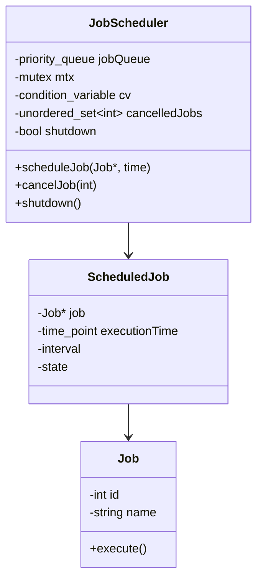

# Task Scheduler — LLD Interview Notes

For the goal of understanding different systems so you don't go blank in an interview, you've covered enough Task Scheduler LLD. You already know the producer-consumer model, thread pools, mutexes and condition variables. The only major addition was **time-based scheduling**.

I wouldn't spend more time implementing advanced features right now. Here are your revision notes.

Code in this folder:

- `JobScheduler.h` — **executor** (FIFO queue, run as soon as a worker is free). Not a scheduler.
- `JobScheduler2.h` — **scheduler** (min-heap by time, `wait_until`).

---

## Class diagram

```text
scheduleJob(job, executionTime)
              |
              v
      Min-Heap by Time
              |
              v
       Worker Threads
              |
       +------+------+
       |             |
  Future job      Due job
       |             |
       v             v
 cv.wait_until()   Pop job
                     |
                     v
                Unlock mutex
                     |
                     v
                  Execute
```



**Interview line:** *Min-heap by execution time. Workers `wait_until` the top. Notify on insert so an earlier job isn't late. Pop under the lock, execute after unlock. Recurring = reinsert. Cancel = lazy set of IDs.*

---

## 1. Requirements

Design an in-memory scheduler supporting:

- One-time tasks scheduled for a future time.
- Recurring tasks executed at fixed intervals.
- Multiple worker threads executing tasks concurrently.
- Task cancellation.
- Graceful shutdown.

### Task Executor vs Task Scheduler

| Task Executor | Task Scheduler |
|---|---|
| Executes tasks as soon as workers are available | Executes tasks at a specified time |
| FIFO queue | Min-heap ordered by execution time |
| `cv.wait()` | `cv.wait()` + `cv.wait_until()` |

A scheduler is essentially a task executor with **time-based execution logic**.

---

## 2. Core classes

| Class | Responsibility |
|---|---|
| `Job` | Job ID and executable logic |
| `JobScheduler` | Schedules, cancels and manages jobs |
| `ScheduledJob` | Job, execution time, recurring interval and state |
| Worker threads | Execute eligible jobs |

Data structures:

```cpp
priority_queue<ScheduledJob, vector<ScheduledJob>, Compare> jobQueue;
mutex mtx;
condition_variable cv;
unordered_set<int> cancelledJobs;
bool shutdown = false;
```

The priority queue must be a **min-heap**, with the earliest execution time at the top.

Complexities: insertion **O(log N)**, earliest-job lookup **O(1)**, removal **O(log N)**.

---

## 3. Basic execution flow

### Worker logic

```cpp
void executionWorker() {
    while (true) {
        unique_lock<mutex> lock(mtx);

        cv.wait(lock, [&]() {
            return shutdown || !jobQueue.empty();
        });

        if (shutdown)
            return;

        auto [time, job] = jobQueue.top();

        if (time > chrono::system_clock::now()) {
            cv.wait_until(lock, time);
            continue;
        }

        jobQueue.pop();
        lock.unlock();

        job->execute();
    }
}
```

This is the core idea, not a complete production implementation. It assumes the heap is correctly ordered and jobs have valid lifetimes.

Important: **Pop the job while holding the mutex, but execute it after releasing the mutex.** Otherwise, one long-running job blocks other workers from accessing the queue.

---

## 4. How `condition_variable` works

This was one of your main questions.

When a worker calls:

```cpp
cv.wait_until(lock, executionTime);
```

The following happens:

1. The worker releases the mutex and waits.
2. It wakes when the deadline arrives, another thread notifies it, or a spurious wakeup occurs.
3. It attempts to reacquire the mutex.
4. Once it owns the mutex, `wait_until()` returns.
5. The worker rechecks the queue and execution time.

If another thread holds the mutex when the deadline arrives, the worker waits until it can reacquire it.

### Why notify when a new job arrives?

Suppose:

- Worker is waiting until 10:15.
- At 10:05, a new job is inserted for 10:07.
- `scheduleJob()` calls `cv.notify_all()`.
- The worker wakes, rechecks the min-heap and starts waiting for 10:07 instead.

Without notification, the new earlier job could be executed **late**.

For your design, `notify_all()` is a simple way to ensure workers reconsider their deadlines.

---

## 5. Multiple workers vs one scheduler thread

We discussed two valid approaches.

### Approach A: Your design

```text
Min-Heap
   |
   +── Worker 1: Wait + Execute
   +── Worker 2: Wait + Execute
   +── Worker 3: Wait + Execute
```

Each worker checks the next execution time, waits if necessary, and executes due jobs.

**Advantages:** Simple implementation, one shared heap, no separate ready queue.

**Disadvantage:** Multiple workers may wake unnecessarily whenever jobs are inserted or cancelled.

### Approach B: Separate scheduler and workers

```text
Min-Heap
   |
   v
Scheduler Thread
   |
   v
Ready FIFO Queue
   |
   +── Worker 1
   +── Worker 2
   +── Worker 3
```

The scheduler thread manages deadlines. Workers only execute jobs that are ready.

This gives cleaner separation but requires another queue and additional coordination.

For your machine-coding preparation, **Approach A is sufficient**.

---

## 6. Recurring tasks

A recurring task is inserted into the min-heap again after execution.

For example, a task that runs every 5 minutes:

```text
nextExecutionTime = completionTime + interval;
```

The first execution can be immediate, after one interval, or at a caller-specified start time. This is an API decision.

### Fixed delay vs fixed rate

| Fixed Delay | Fixed Rate |
|---|---|
| Next execution is scheduled relative to **completion** | Next execution is scheduled relative to the previous **planned** time |
| `completionTime + interval` | `previousScheduledTime + interval` |
| Naturally avoids overlap if rescheduled after completion | Needs an explicit overlap / missed-run policy |

Example: A job takes 2 minutes and has a 5-minute interval.

- **Fixed delay:** Starts at 10:00, 10:07, 10:14.
- **Fixed rate:** Scheduled for 10:00, 10:05, 10:10.

For LLD, **fixed delay is simpler**.

For fixed-rate jobs, if execution takes longer than the interval, decide whether overlapping runs are allowed, skipped or delayed.

---

## 7. Task cancellation

You initially proposed finding a job inside the priority queue and erasing it.

The issue is that C++ `priority_queue` doesn't support arbitrary removal.

A simpler solution is **lazy cancellation**:

```cpp
unordered_set<int> cancelledJobs;
```

On cancellation:

```cpp
void cancelJob(int jobId) {
    lock_guard<mutex> lock(mtx);
    cancelledJobs.insert(jobId);
    cv.notify_all();
}
```

When a cancelled job reaches the top of the heap, remove it without executing.

For recurring jobs, cancellation must also prevent future rescheduling. The cancellation state should remain associated with the recurring job until it is fully terminated.

Concurrency edge case: If a job has **already started executing**, cancellation cannot automatically stop it. A reasonable initial contract is that cancellation only prevents jobs that **haven't started**.

---

## 8. Graceful shutdown

Maintain a shutdown flag.

```cpp
{
    lock_guard<mutex> lock(mtx);
    shutdown = true;
}

cv.notify_all();
```

All waiting workers wake and check the flag.

The scheduler then joins its worker threads.

There are two possible shutdown policies:

- **Immediate shutdown:** Stop accepting new jobs, discard pending jobs and let running jobs finish.
- **Graceful drain:** Stop accepting new jobs and finish eligible pending jobs before stopping.

Be careful with future-scheduled jobs during graceful shutdown: waiting hours for them may be undesirable. Define whether they are cancelled or executed immediately.

---

## 9. Common interviewer follow-ups

| Question | Answer |
|---|---|
| Why a priority queue? | Earliest scheduled job must be processed first |
| Why not a normal FIFO queue? | Insertion order may differ from execution-time order |
| Why `wait_until()`? | Wait efficiently until a deadline while allowing early notification |
| What if an earlier job arrives? | Notify workers and recheck heap |
| Why unlock before executing? | Allow other workers to access the queue concurrently |
| Why multiple workers? | Execute independent jobs concurrently |
| What if a job takes too long? | Other workers can execute other jobs; recurring overlap policy must be defined |
| How to cancel a job? | Lazy cancellation using job IDs or shared state |
| How to implement recurring jobs? | Reinsert with next execution time |
| What if the process crashes? | In-memory jobs are lost; durable storage is needed |
| How to avoid duplicate execution across servers? | Atomic job claiming, leases and idempotent execution |

The last two are **HLD** topics; no need to implement them in your current LLD.

---

## 10. One-minute interview summary

> I'd design an in-memory Task Scheduler using a min-heap ordered by execution time, protected by a mutex and condition variable. Multiple worker threads wait until the earliest task becomes due using `wait_until()`. If a new earlier task arrives, workers are notified and recheck the heap. When a task becomes due, a worker removes it under the mutex, releases the lock and executes it. Recurring tasks are rescheduled using their interval, cancellation can use lazy deletion, and shutdown is coordinated through a shared flag.

---

**Recommendation:** Mark Task Scheduler LLD as done. You've covered enough to explain the design, write its core implementation and handle the most likely concurrency follow-ups. Spend remaining preparation time on other systems rather than going deeper into scheduler internals.
