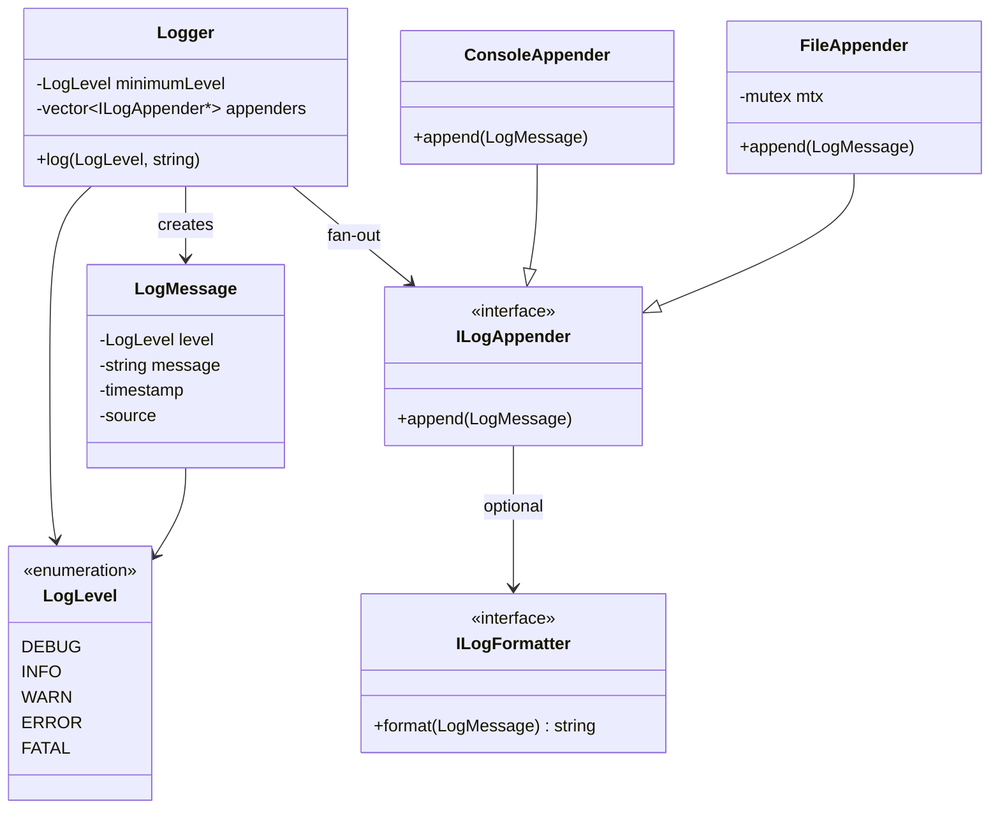

# Logging System — LLD + HLD Interview Notes

A logging system records application events: debugging, successes, warnings, errors. Goal: make apps **observable** without wrecking **performance**.

---

## Overall class diagram (LLD)

```text
Application
    |
    v
Logger.log(level, message)
    |
    v
Check minimum log level
    |
    v
Create LogMessage
    |
    v
Dispatch to appenders
    |
    +── ConsoleAppender
    |
    +── FileAppender
```



**Interview line:** *Logger filters by level and fans out to appenders. Sync writes on the caller; async is a bounded queue + worker. Per-appender mutex. Collectors + Splunk are HLD — not extra classes in LLD.*

---

# Part 1: Low-Level Design (LLD)

## 1. Functional requirements

- Log at **DEBUG, INFO, WARN, ERROR, FATAL**
- Multiple destinations: console, file
- Minimum level **globally**, optionally **per appender**
- Sync and async
- Concurrent logging from many threads
- Optionally: formatting, rotation, runtime config

---

## 2. Core classes

| Class | Responsibility |
|---|---|
| **Logger** | Entry point; filtering and dispatch |
| **LogMessage** | Message, level, timestamp, source |
| **LogLevel** | Severity enum |
| **ILogAppender** | Interface for writing logs |
| **ConsoleAppender** | stdout / stderr |
| **FileAppender** | File |
| **ILogFormatter** | Optional JSON / plain text |

`LoggerService` / `LoggerManager` is **not** needed at first. `Logger` can orchestrate.

---

## 3. Basic synchronous logging

```cpp
void Logger::log(LogLevel level, string message) {
    if (level < minimumLevel)
        return;

    LogMessage logMessage(level, message);

    for (auto* appender : appenders) {
        appender->append(logMessage);
    }
}
```

The **application thread waits** until appenders finish writing.

---

## 4. Log-level filtering

Severity order:

```text
DEBUG < INFO < WARN < ERROR < FATAL
```

If minimum is **WARN**, DEBUG and INFO are discarded.

Filtering at **two** levels:

- **Logger-level** — drop below global threshold before processing
- **Appender-level** — each destination decides what it accepts

Example: Logger = DEBUG, Console = INFO, File = ERROR.

- ERROR → both appenders
- INFO → console only

Configure via constructors, setters, or config files.

The **global** Logger threshold must **not** drop messages an appender still needs.

---

## 5. Thread safety

Many threads logging at once → protect shared output.

**Preferred:** each appender owns a mutex for **its** output.

```cpp
class FileAppender : public ILogAppender {
    mutex mtx;

public:
    void append(const LogMessage& msg) override {
        lock_guard<mutex> lock(mtx);
        // Write complete formatted message to file
    }
};
```

Per-appender mutexes avoid serializing **independent** destinations.

If two appenders write the **same** underlying file, they must **share** synchronization.

---

## 6. Asynchronous logging

Sync file writes can **block** the app. Async: thread-safe queue + worker.

```text
Application Threads
        |
        v
      Logger
        |
        v
  Thread-safe Queue
        |
        v
   Worker Thread
        |
        +── ConsoleAppender
        |
        +── FileAppender
```

App thread **enqueues and returns**. Worker consumes and forwards to every appender.

Uses `queue<LogMessage>`, `mutex`, `condition_variable`, worker thread.

**One queue + one worker** is the simplest interview design. Queue order is preserved if appenders write sync and succeed.

**Multiple workers:** each can take a different message and send to all appenders. Finish order may **not** match enqueue order. Per-appender mutexes prevent **corrupted** writes, not **chronological** order. Extra workers often don’t help if everyone contends on one slow file.

---

## 7. Bounded queue and overflow

Unlimited queue → OOM if logs arrive faster than the worker.

| Overflow policy | Behavior | Tradeoff |
|---|---|---|
| **BLOCK** | Wait for queue space | Slows the app |
| **DROP_NEWEST** | Discard incoming | Loses recent logs |
| **DROP_OLDEST** | Evict oldest queued | Loses earlier logs |
| **REJECT** | Return failure | Caller handles it |
| **SYNC_FALLBACK** | Write directly | May block the app |

Policy depends on **reliability**. Ordinary diagnostics: dropping low-priority can be OK. **Audit** events need something more durable.

Track a **dropped-log counter**. Don’t log overflow errors **back into the same overloaded queue**.

---

## 8. Shutdown, rotation, formatting

**Graceful shutdown:** stop accepting new logs → wake worker → drain queue → flush appenders → join worker. A **forced crash** can still lose in-memory messages.

**Log rotation:** `FileAppender` rotates on size / age: `app.log`, `app.log.1`, `app.log.2`. Caps storage. Does **not** guarantee delivery.

**Formatting:** `LogMessage` → string / JSON. Useful: timestamp, severity, service name, thread ID, correlation / request ID, message.

Avoid passwords, tokens, extra sensitive data.

---

## 9. Design patterns

| Pattern | Where |
|---|---|
| **Strategy** | Appender and formatter implementations |
| **Observer-like fan-out** | Logger → many appenders |
| **Singleton (optional)** | Shared Logger in one process. Not required; DI is fine |
| **Producer–Consumer** | Queue between app threads and async workers |

### LLD interview recommendation

Implement: `Logger`, `LogMessage`, `LogLevel`, `ILogAppender`, `ConsoleAppender`, `FileAppender`, level filtering, basic thread safety.

Add **async bounded queue** when asked.

**Explain** rotation and delivery policies — don’t implement everything up front.

---

# Part 2: High-Level Design (HLD)

## 1. Overall architecture

Each running service instance has its **own local Logger**. The Logger is an **in-process library**, not a network service.

```text
Service A                 Service B
   |                         |
   v                         v
 Local Logger             Local Logger
   |                         |
   v                         v
stdout / file            stdout / file
   |                         |
   +------------+------------+
                |
                v
        Log Collectors
                |
                v
       Central Ingestion
                |
                v
          Splunk
                |
                v
        Search / Analysis
```

A collector reads app log files or captures stdout via the server’s logging stack. It **batches** and forwards to the central backend.

---

## 2. ConsoleAppender vs FileAppender

| | |
|---|---|
| **ConsoleAppender** | stdout / stderr. Server logging infra may capture this. |
| **FileAppender** | App-managed file. Collector tails it. |

You don’t **need** both. Both for the same messages → **duplicate** logs.

Other appenders: rolling-file, network, DB. A **direct network** appender is possible but puts network failures and backpressure on the logging path unless buffered.

---

## 3. Why collectors?

Don’t HTTP to Splunk on **every** event. App writes **locally**; collector **forwards**.

Collectors: batching, retries, buffering, filtering, parsing, **checkpointing**. Less coupling to the remote platform.

Collector runs continuously — does **not** wait for app restart.

---

## 4. Splunk unavailable

Suppose Splunk is down 30 minutes:

1. Apps keep writing **locally**
2. Collectors fail to forward
3. Collectors **retry**, maybe **disk-backed** buffers
4. Splunk recovers → collectors send pending logs

This only works while logs **still exist**. Server crash, storage gone, files rotated away, buffer overflow → **loss**.

An **in-memory async Logger queue** is especially vulnerable to process crash. Disk-persisted records have a better chance, subject to storage durability.

---

## 5. Checkpointing and duplicate delivery

Collector tracks how far it has **read / delivered**. Checkpoint might be **file + byte offset**.

```text
Collector sends logs 101–200
Splunk receives them
Collector crashes before saving checkpoint
Collector restarts
Collector resends 101–200   ← duplicates
```

Practical: **at-least-once** + durable checkpoints. Duplicates possible; retries reduce **loss**.

Need dedup: stable IDs (source + file + offset) and dedup at an ingestion layer that supports it.

A checkpoint alone is **not** exactly-once. Don’t assume Splunk auto-deduplicates.

---

## 6. Backpressure and disk limits

Logs faster than forward → local buffers grow.

Mitigations: bounded buffers, disk-backed buffering, rotation, retention, drop low-priority diagnostics, **alert on disk**.

Tradeoff:

- **App availability** — don’t block critical work because ordinary logging is overloaded
- **Log reliability** — don’t lose security / financial **audit** events

Critical audit: stronger durable storage and explicit delivery, maybe **inside the business transaction**.

---

## 7. Logs vs metrics vs alerting

| System | Purpose | Example |
|---|---|---|
| **Splunk** | Search / analyze individual log events | Investigate a timeout exception |
| **SignalFx / Splunk Observability** | Metrics, dashboards, alerting | p95 latency, request rate, error rate |
| **Opsgenie** | Incident notification / on-call | Page the on-call engineer |

**Logs** = individual event detail. **Metrics** = numbers over time (counts, error rate, latency).

Metrics often **rolled up**. Logs usually **batched** but still individual events. Both can use collectors and push.

Typical incident: **metrics detect** → alert pages on-call → **logs** to find the cause.

---

## 8. Scalability

As volume grows, a central pipeline may add:

- Collectors on each app server
- Batching + compression
- Horizontally scaled ingestion
- Optional durable **queues** (buffer / decouple)
- Retention + indexing strategy
- Search by service, severity, timestamp, request / correlation ID

Indexing **every** field is expensive. Retention and indexing follow **search needs and cost**.

---

## 9. Important interview tradeoffs

| Question | Good answer |
|---|---|
| Sync or async? | Sync is simpler. Async unblocks the app thread; queued logs can die on crash. |
| One worker or many? | Start with **one** (simple + order). Scale if needed. |
| Queue fills? | **Bounded** queue + explicit block / drop policy. |
| Splunk down? | Local persist / buffer, collector retries, monitoring. |
| Collector crashes? | Resume from **durable checkpoint**; duplicates may happen. |
| Prevent duplicates? | Stable event IDs + ingestion-side dedup if required. |
| Disk fills? | Retention, rotation, bounded buffers, alerts, defined loss vs block. |
| Preserve order? | Single worker or per-source sequencing. Global order is expensive. |
| Logs = metrics? | No. Logs = event detail. Metrics = aggregated health numbers. |

---

## Final interview summary

**LLD:** In-process `Logger` filters by severity and dispatches to appenders. Sync writes immediately. Async = bounded thread-safe queue + worker. Appenders own output locks. Overflow, shutdown, and ordering need **explicit** policies.

**HLD:** Each instance logs locally. Collectors read stdout or files, batch, forward to Splunk (or similar). Retries + checkpoints → resilient delivery, but **duplicates and loss** are still possible. Production: buffering, disk limits, retention, observability, failure isolation.

**Bar-raiser focus:** async vs sync, producer–consumer, queue overflow, collector failures, checkpointing, delivery guarantees, logs vs metrics. That’s where a basic Logger LLD becomes a system-design conversation.
