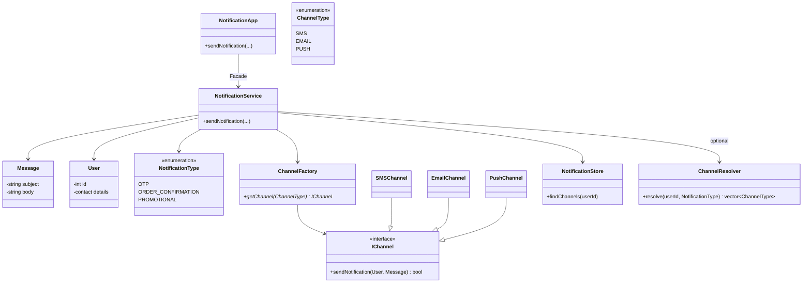

# Notification System — LLD + HLD Notes

These notes cover our complete discussion so far: your initial design, synchronous vs asynchronous execution, fire-and-forget threads, queues, concurrency, user preferences, and the HLD reliability follow-ups.

---

## Overall class diagram (LLD)

```text
NotificationApp
      |
      v
NotificationService
      |
      +── NotificationStore.findChannels(userId)
      |
      +── ChannelFactory.getChannel(channelType)
      |                  |
      |                  v
      |               IChannel
      |                  |
      |        +---------+---------+
      |        |         |         |
      |       SMS       Email     Push
      |        |         |         |
      |        v         v         v
      |      External providers
      |
      v
  Delivery result
```



**Interview line:** *Facade → Service → Factory → IChannel. Async = bounded queue + worker pool, not detached threads. OTP vs preferences = ChannelResolver. Crash-safe HLD = durable store + SKIP LOCKED + idempotency key.*

---

# Part 1: Low-Level Design (LLD)

## 1. Requirements

Design a notification system that allows application services to send notifications to users through different channels.

Functional requirements:

- Support SMS, Email and Push notifications.
- Send notifications to one or multiple users.
- Support user-specific channel preferences.
- Support notification types such as OTP, promotional and order confirmation.
- Allow new channels and providers to be added easily.
- Handle failures and asynchronous execution.

---

## 2. Core entities and classes

| Component | Responsibility |
|---|---|
| `NotificationApp` | Facade exposing `sendNotification()` |
| `NotificationService` | Orchestrates notification delivery |
| `Message` | Subject, body and other message content |
| `User` | User ID and contact details |
| `NotificationType` | OTP, ORDER_CONFIRMATION, PROMOTIONAL |
| `ChannelType` | SMS, EMAIL, PUSH |
| `IChannel` | Interface for sending notifications |
| `SMSChannel` | SMS-specific delivery |
| `EmailChannel` | Email-specific delivery |
| `PushChannel` | Push-specific delivery |
| `ChannelFactory` | Returns the correct channel implementation |
| `NotificationStore` | Stores user channel preferences |
| `ChannelResolver` | Optional component for resolving routing rules |

---

## 3. Your initial design

Your original design is valid. `NotificationService` coordinates delivery, while individual channels handle channel-specific behavior.

Example interface:

```cpp
class IChannel {
public:
    virtual bool sendNotification(
        const User& user,
        const Message& message
    ) = 0;

    virtual ~IChannel() = default;
};
```

Design patterns:

- **Strategy:** Different channel implementations share a common interface.
- **Factory:** Selects the appropriate channel implementation.
- **Facade:** `NotificationApp` provides a simple API to callers.

No need to introduce additional classes unless requirements justify them.

---

## 4. Synchronous vs asynchronous notifications

This was one of your main questions: Is notification delivery usually synchronous or asynchronous?

**Synchronous execution:**

```text
OrderService
     |
     v
NotificationService
     |
     v
EmailProvider (network call)
     |
     v
Return result
```

The application thread waits for the provider response. If the provider takes 3 seconds, the caller can be blocked for 3 seconds.

**Asynchronous execution (commonly preferred):**

```text
OrderService
     |
     v
NotificationService
     |
     v
Queue
     |
     v
Worker Threads
     |
     v
Email / SMS / Push Provider
```

The caller submits a notification and continues without waiting for the external provider to complete.

Important: A successful asynchronous API response generally means **accepted for processing**, not delivered to the user.

---

## 5. Can we simply use a separate thread instead of a queue?

You suggested starting a background thread for each notification.

Yes, that works for a simple application.

```cpp
void NotificationService::sendNotification(
    int userId,
    string message
) {
    thread([this, userId, message]() {
        sendNotificationInternal(userId, message);
    }).detach();
}
```

However, detached threads have limitations:

- 10,000 notifications could create 10,000 threads.
- Threads consume memory and system resources.
- External providers may be overwhelmed.
- Shutdown and error handling become difficult.
- Capturing `this` is unsafe if the service object is destroyed before the detached thread finishes.

Better scalable approach: **Fixed-size worker pool + bounded queue.**

```text
Application Thread
       |
       v
NotificationService
       |
       v
Bounded Queue
       |
       +----------+----------+
       |          |          |
    Worker 1   Worker 2   Worker 3
       |          |          |
       v          v          v
    Provider   Provider   Provider
```

For example, with 5 workers and 100 pending notifications, only 5 notifications execute concurrently while the others wait in the queue.

The queue separates the rate at which notifications arrive from the rate at which providers can process them.

---

## 6. Who is the producer?

You asked whether `NotificationApp` itself is the producer.

Technically, the thread calling `NotificationApp.sendNotification()` is the producer.

```text
OrderService Request Thread (Producer)
               |
               v
        NotificationApp
               |
               v
       NotificationService
               |
               v
          Shared Queue
               |
               v
      Worker Threads (Consumers)
               |
               v
        External Providers
```

`NotificationApp` and `NotificationService` are ordinary classes, not automatically separate threads.

If enqueueing blocks, the calling application thread blocks too.

---

## 7. Bounded queue and overflow strategies

We discussed what happens when 1,000 notifications arrive, but there are only 5 workers and a queue capacity of 100.

Assuming no worker completes during the burst, 5 notifications are being processed, 100 are queued, and 895 cannot be admitted immediately.

You correctly identified that handling this depends on business requirements.

| Strategy | Behavior | Tradeoff |
|---|---|---|
| **BLOCK** | Producer waits for free space | Slows application requests |
| **REJECT** | Return `QUEUE_FULL` | Caller must handle rejection |
| **DROP_NEWEST** | Discard incoming notification | Loses new notifications |
| **DROP_OLDEST** | Remove older queued notification | Loses older notifications |
| **PERSIST** | Store excess work durably | Additional storage and processing complexity |

For ordinary notifications, bounded waiting or explicit rejection is generally preferable to silently dropping messages. Important notifications often require durable persistence.

---

## 8. How does the producer wait when the queue is full?

Using `mutex` and `condition_variable`.

A bounded queue can use:

- `notFull`: Producers wait when the queue reaches capacity.
- `notEmpty`: Workers wait when there is no work.

```cpp
void enqueue(Notification notification) {
    unique_lock<mutex> lock(mtx);

    notFull.wait(lock, [&]() {
        return queue.size() < capacity || stopping;
    });

    if (stopping)
        return;

    queue.push(std::move(notification));
    notEmpty.notify_one();
}
```

`condition_variable::wait()` releases the mutex while waiting and reacquires it before continuing.

Workers should remove notifications under the mutex but **release the mutex before making slow network calls**.

If the requirement is that the caller must never wait for queue capacity, use a nonblocking enqueue that returns `QUEUE_FULL`.

---

## 9. Multiple channels per user

Your initial store:

```cpp
unordered_map<int, ChannelType> userChannels;
```

supports only one channel per user.

For multiple channels:

```cpp
unordered_map<int, vector<ChannelType>> userChannels;
```

Now a user can receive the same notification through Email and Push, depending on the routing policy.

Your existing `IChannel` and `ChannelFactory` already support this. `NotificationService` simply iterates over the resolved channels.

---

## 10. Notification types vs user preferences

You identified a potential conflict: the system might require SMS for OTP, while a user prefers Email.

You proposed separate mappings for notification-type channels and user preferences, then resolving conflicts according to business rules. That is a sound approach.

For example:

```cpp
unordered_map<NotificationType, vector<ChannelType>>
    notificationTypeChannels;

unordered_map<int,
    unordered_map<NotificationType, vector<ChannelType>>>
    userPreferences;
```

Possible policies:

- **OTP:** Mandatory system-defined channel.
- **Promotional:** Respect user opt-in and preferred channels.
- **Order confirmation:** Use supported channels selected by the user.
- **No valid channel:** Apply an explicit fallback or reject the request.

For complex rules, introduce:

```cpp
class ChannelResolver {
public:
    vector<ChannelType> resolve(
        int userId,
        NotificationType type
    );
};
```

This separates routing decisions from notification delivery.

For simple requirements, keeping the logic in `NotificationService` is acceptable.

---

## 11. Multiple recipients and partial failures

Suppose notifications are sent to three users:

- User 1 succeeds.
- User 2 fails.
- User 3 has not yet been processed.

A reasonable approach is to continue processing independent recipients rather than stopping the entire batch. Collect per-recipient or per-channel results so failed deliveries can be identified.

For an asynchronous API, distinguish initial **acceptance** results from eventual **delivery** results.

---

## 12. Provider extensibility

You already separated channel implementations from external providers:

```text
NotificationService
       |
       v
    SMSChannel
       |
       v
   SMSProvider
```

This is good design.

If multiple SMS providers are required, such as a primary provider and a fallback provider, introduce a provider interface and configurable provider selection rather than hardcoding a specific provider inside `NotificationService`.

We have not yet fully explored this follow-up.

---

# Part 2: High-Level Design (HLD)

We touched on these topics while discussing queues and failures. You can revisit them in more depth during dedicated HLD preparation.

## 1. Is Notification Service part of the same application?

You asked whether calling Notification Service means a function call or a network request.

Both architectures are valid.

**In-process LLD:**

```text
OrderService
    |
    v
NotificationApp (class)
    |
    v
NotificationService (class)
    |
    v
Local Queue / Workers
```

**Separate notification microservice:**

```text
Order Service
    |
    | HTTP request or event
    v
Notification Microservice
    |
    v
Durable Queue / Database
    |
    v
Workers
    |
    v
External Providers
```

A separate microservice enables reuse by multiple business services, independent scaling and centralized delivery management.

For your LLD interview, the in-process design is sufficient unless the interviewer asks about distributed deployment.

---

## 2. Why persist notifications?

You correctly proposed a database when the in-memory queue becomes full or the application might crash.

```text
OrderService
     |
     v
NotificationService
     |
     v
Database (PENDING)
     |
     v
Workers
     |
     v
External Provider
     |
     v
Database (SENT / FAILED)
```

A simple notification record:

| Field | Purpose |
|---|---|
| `id` | Unique notification identifier |
| `userId` | Recipient |
| `channel` | SMS, Email or Push |
| `status` | PENDING, PROCESSING, SENT, FAILED |
| `retryCount` | Number of attempts |
| `nextRetryAt` | Next eligible retry time |
| `lockedUntil` | Worker lease expiration |

The database provides a durable backlog. A separate in-memory queue is not strictly necessary for this basic architecture.

---

## 3. How do multiple workers avoid picking the same notification?

You suggested atomically marking notifications as processing using conditional locking.

Correct.

In PostgreSQL, one approach is:

```sql
BEGIN;

SELECT id
FROM notifications
WHERE status = 'PENDING'
ORDER BY id
LIMIT 1
FOR UPDATE SKIP LOCKED;

UPDATE notifications
SET status = 'PROCESSING'
WHERE id = :selected_id;

COMMIT;
```

`SKIP LOCKED` allows other workers to select different unlocked rows.

The worker then makes the external provider call **after committing**, so a slow network call doesn't hold database locks.

---

## 4. What if a worker crashes after claiming a notification?

A notification can remain stuck in `PROCESSING`.

Introduce a lease, for example `lockedUntil`.

If the worker does not complete before the lease expires, another worker can reclaim the notification.

For production correctness, the worker should also have a claim token or attempt version so a stale worker cannot overwrite the result of a newer claim.

---

## 5. What if the provider sends successfully but the worker crashes?

This was our idempotency discussion.

```text
Worker sends SMS
       |
       v
Provider sends successfully
       |
       v
Worker crashes before DB update
       |
       v
Another worker retries
       |
       v
Possible duplicate SMS
```

Your solution was correct: use an **idempotency key** if the provider supports it.

The same logical notification should use the same persisted idempotency key across retries.

If the provider recognizes that key, it can suppress duplicate sends.

However, not all providers support idempotency, and some only retain keys for a limited period. Without provider-side cooperation, exactly-once external delivery generally cannot be guaranteed.

---

## 6. What if the notification queue is full?

For important notifications, you proposed storing them in a persistent database and processing them when workers become available.

Correct.

But persistence has limits too: database writes can fail, storage can fill, and the system needs a capacity and retry policy.

If the business transaction and notification are stored in different services, a failure between the two writes can create inconsistency.

For example, an order may be committed but its notification request never reaches the notification service. The **transactional outbox** pattern is one way to address this.

---

## 7. Retry strategies

We identified this as the next HLD topic but haven't explored it in detail.

Common mechanisms include exponential backoff, retry limits, delayed scheduling, dead-letter storage for repeatedly failing notifications and provider failover.

Immediate unlimited retries are dangerous because they can overload an already failing provider.

---

# Part 3: Interview follow-ups covered

| Question | Key takeaway |
|---|---|
| Is notification delivery synchronous or asynchronous? | Usually asynchronous for production-scale systems |
| Can we create a separate thread instead of a queue? | Yes, but unbounded detached threads don't scale safely |
| Why use a queue? | Buffers pending work and limits concurrent execution |
| Who is the producer? | The application thread calling the notification API |
| Does the caller block when the queue is full? | Yes under BLOCK policy; not under REJECT |
| How do producers wait? | `condition_variable` with a `notFull` condition |
| What happens when the queue fills? | Block, reject, drop or persist, depending on requirements |
| How do we prevent loss after a crash? | Durable database or message queue |
| How do workers avoid duplicate claims? | Atomic claim, row locking, `SKIP LOCKED` |
| What if a worker crashes while processing? | Lease expiration and recovery |
| What if sending succeeds but status update fails? | Stable idempotency key, if provider supports it |
| How do we support multiple channels? | Resolve a collection of channels and dispatch through `IChannel` |
| How do user preferences interact with notification types? | Explicit routing policies, optionally a `ChannelResolver` |
| Is Notification Service a separate microservice? | In LLD it can be in-process; in HLD it may be separate |

---

## Final revision summary

**LLD:** A Notification System exposes a simple API through `NotificationApp`. `NotificationService` orchestrates delivery, resolves user preferences and notification-type routing, selects channel implementations through a factory, and invokes external providers. For asynchronous execution, use a bounded thread-safe queue with a fixed worker pool rather than creating unlimited detached threads.

**HLD:** A production notification platform can be a separate service with durable notification storage, background workers, atomic job claiming, leases, retries and idempotency. The primary challenges are preventing lost notifications, controlling overload, handling partial failures and minimizing duplicate delivery.

For your SDE2 preparation: Your core LLD is sufficient. The two remaining useful LLD follow-ups are provider fallback (Twilio → MSG91) and per-recipient delivery results. After that, move on to the next system rather than spending too much time expanding Notification System HLD right now.
